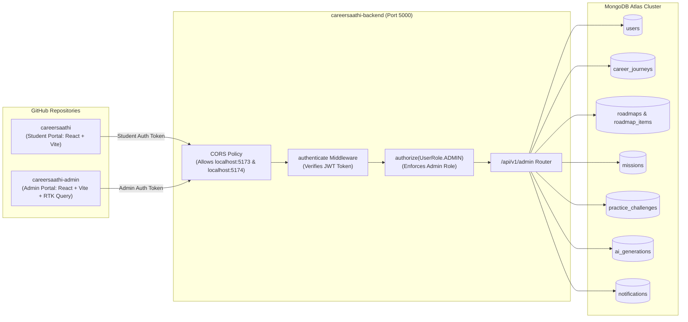
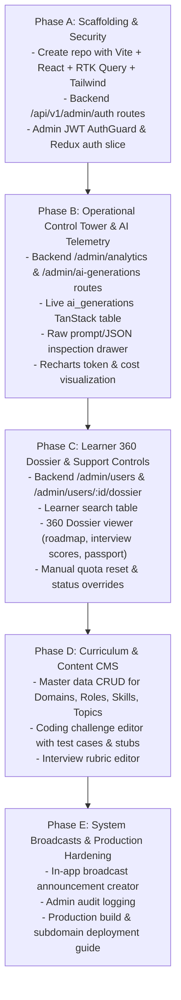

# CareerSaathi Admin Panel — Master Architecture & Implementation Blueprint

> **Notice for New Admin Repository Session**:  
> This document is the authoritative architectural specification and implementation guide for the dedicated `careersaathi-admin` repository. It provides complete API contracts, RTK Query design patterns, database mapping, UI/UX requirements, and a step-by-step implementation roadmap.

---

## 1. System Overview & Deployment Architecture

The CareerSaathi platform separates the learner-facing surface from administrative operations:



### Architectural Principles
1. **Single Source of Truth for Data**: The admin panel does **not** connect directly to MongoDB. It consumes dedicated `/api/v1/admin/*` endpoints exposed by `careersaathi-backend`. This eliminates schema duplication and preserves all business validations.
2. **Strict Role-Based Access Control (RBAC)**: All administrative routes are locked behind `authenticate` and `authorize(UserRole.ADMIN)`. A non-admin user token immediately receives a `403 Forbidden` response.
3. **Dedicated Admin Session Isolation**: The admin frontend runs on port `5174` locally (production: `admin.careersaathi.com`), preventing session contamination between a developer testing student flows and admin operations.
4. **Comprehensive AI Observability**: Direct querying capability over the `ai_generations` telemetry collection created in Phase 1, allowing real-time token tracking, latency auditing, and raw prompt/response inspection.

---

## 2. Technology Stack & Directory Structure

### Approved Tech Stack
- **Framework**: React 19 + TypeScript + Vite
- **Data Fetching & State**: **Redux Toolkit (RTK) & RTK Query**
- **Styling**: Tailwind CSS v3 / v4
- **Data Tables**: TanStack Table v8 (sorting, filtering, pagination, column toggles)
- **Charts & Telemetry**: Recharts
- **Forms & Validation**: React Hook Form + Zod
- **Icons**: Lucide React
- **Notifications/Alerts**: React Hot Toast

### Recommended `careersaathi-admin` Directory Structure

```
careersaathi-admin/
├── index.html
├── package.json
├── tsconfig.json
├── vite.config.ts
├── tailwind.config.js
├── src/
│   ├── main.tsx
│   ├── App.tsx
│   ├── app/
│   │   ├── store.ts                         # Redux Store with RTK Query middleware
│   │   ├── hooks.ts                         # useAppDispatch, useAppSelector
│   │   └── router/
│   │       ├── index.tsx                    # React Router definitions
│   │       └── AdminRouteGuard.tsx          # Protects routes against non-ADMIN roles
│   ├── shared/
│   │   ├── api/
│   │   │   ├── adminBaseApi.ts              # RTK Query baseApi with tag definitions
│   │   │   └── interceptors.ts              # Bearer token injection & 401 handling
│   │   ├── components/
│   │   │   ├── layout/
│   │   │   │   ├── AdminLayout.tsx          # Sidebar + Topbar + Content shell
│   │   │   │   ├── AdminSidebar.tsx         # Navigation links
│   │   │   │   └── AdminTopbar.tsx          # Current admin badge, breadcrumb, logout
│   │   │   ├── ui/
│   │   │   │   ├── DataTable.tsx            # Generic TanStack Table component
│   │   │   │   ├── StatCard.tsx             # Metric KPI card
│   │   │   │   ├── Badge.tsx                # Status badges
│   │   │   │   ├── JsonModal.tsx            # Raw JSON / Prompt viewer
│   │   │   │   └── ConfirmDialog.tsx        # Destructive action confirmation modal
│   │   │   └── types/
│   │   │       └── admin.types.ts           # Shared admin response interfaces
│   ├── features/
│   │   ├── auth/
│   │   │   ├── api/adminAuthApi.ts          # RTK Query auth endpoints
│   │   │   ├── pages/AdminLoginPage.tsx     # Clean admin credentials form
│   │   │   └── slice/adminAuthSlice.ts      # Stored admin token & profile
│   │   ├── dashboard/
│   │   │   ├── api/dashboardApi.ts          # RTK Query analytics endpoints
│   │   │   ├── components/                  # KPI widgets, AI usage charts
│   │   │   └── pages/DashboardPage.tsx      # Control Tower overview
│   │   ├── users/
│   │   │   ├── api/usersAdminApi.ts         # User list, dossier, quota resets
│   │   │   ├── components/                  # Student 360 dossier, roadmap inspector
│   │   │   └── pages/                       # UserListPage.tsx, UserDetailPage.tsx
│   │   ├── curriculum/
│   │   │   ├── api/curriculumAdminApi.ts    # Domains, roles, skills, topics CRUD
│   │   │   ├── components/                  # Track builder, topic forms
│   │   │   └── pages/                       # CurriculumPage.tsx, SkillEditorPage.tsx
│   │   ├── questions/
│   │   │   ├── api/questionsAdminApi.ts     # Coding challenges, interview rubrics
│   │   │   ├── components/                  # Test case editor, code template editor
│   │   │   └── pages/                       # ChallengesListPage.tsx, ChallengeEditorPage.tsx
│   │   ├── ai-telemetry/
│   │   │   ├── api/aiTelemetryApi.ts        # ai_generations query, prompt viewer
│   │   │   ├── components/                  # Stream table, token graph, prompt drawer
│   │   │   └── pages/AiTelemetryPage.tsx    # Live AI generation monitor
│   │   └── notifications/
│   │       ├── api/broadcastApi.ts          # Broadcast sender
│   │       └── pages/BroadcastPage.tsx      # System-wide announcement creator
```

---

## 3. Backend Admin API Contract (Specification)

All endpoints reside under `/api/v1/admin` in `careersaathi-backend`.

### 3.1 Authentication & Profile
| Endpoint | Method | Description | Access |
| :--- | :--- | :--- | :--- |
| `/api/v1/admin/auth/login` | `POST` | Authenticate admin credentials, verify `role === "ADMIN"`, issue access/refresh tokens. | Public |
| `/api/v1/admin/auth/me` | `GET` | Return authenticated admin profile and permissions. | Admin |

### 3.2 Analytics & Control Tower
| Endpoint | Method | Description |
| :--- | :--- | :--- |
| `/api/v1/admin/analytics/overview` | `GET` | Platform KPIs: Total users, active journeys this week, roadmap completion rate, pass rate. |
| `/api/v1/admin/analytics/ai-usage` | `GET` | Aggregated AI metrics: Tokens today/this month, estimated cost ($), average latency, error rate. |
| `/api/v1/admin/analytics/track-distribution` | `GET` | Breakdown of learners by Target Role and Domain. |

### 3.3 Learner Management & 360° Dossier
| Endpoint | Method | Description |
| :--- | :--- | :--- |
| `/api/v1/admin/users` | `GET` | Paginated search of learners (filter by name, email, target role, status, date). |
| `/api/v1/admin/users/:userId/dossier` | `GET` | Complete 360° profile: user details, active journey, roadmap items, mock interview scores, passport skills, latest reports. |
| `/api/v1/admin/users/:userId/status` | `PATCH` | Change account status (`ACTIVE`, `SUSPENDED`). |
| `/api/v1/admin/users/:userId/reset-quota` | `POST` | Reset user-level rate limits (e.g., reset daily interview or coding evaluation count). |
| `/api/v1/admin/users/:userId/impersonate` | `POST` | Issue a short-lived view-only token allowing support agents to see student workspace. |

### 3.4 Curriculum & Knowledge CMS
| Endpoint | Method | Description |
| :--- | :--- | :--- |
| `/api/v1/admin/curriculum/domains` | `GET, POST` | List all domains / Create new Career Domain. |
| `/api/v1/admin/curriculum/domains/:id` | `PATCH, DELETE` | Update domain name, description, active status. |
| `/api/v1/admin/curriculum/roles` | `GET, POST` | List career roles / Create new Role under a Domain. |
| `/api/v1/admin/curriculum/roles/:id` | `PATCH, DELETE` | Update role metadata, required skills, benchmarks. |
| `/api/v1/admin/curriculum/skills` | `GET, POST` | List / Create Skill Catalog items (category, difficulty, description). |
| `/api/v1/admin/curriculum/skills/:id` | `PATCH, DELETE` | Edit or deprecate skills. |
| `/api/v1/admin/curriculum/topics` | `GET, POST` | Granular curriculum topics under skills with documentation links. |

### 3.5 Question Bank & Coding Challenges CMS
| Endpoint | Method | Description |
| :--- | :--- | :--- |
| `/api/v1/admin/challenges` | `GET, POST` | List and create coding challenges (LeetCode style). |
| `/api/v1/admin/challenges/:id` | `PATCH, DELETE` | Edit problem description, starter stubs, constraints, visible/hidden test cases. |
| `/api/v1/admin/interview-rubrics` | `GET, POST` | Manage mock interview rubrics, technical depth criteria, and persona system prompts. |

### 3.6 AI Operations & Telemetry (Observability)
| Endpoint | Method | Description |
| :--- | :--- | :--- |
| `/api/v1/admin/ai-generations` | `GET` | Paginated search of `ai_generations` collection. Filters: feature (`ROADMAP_GENERATE`, `CODING_EVALUATION`, `INTERVIEW_SESSION`, `REPORT`), model, status (`SUCCESS`, `FAILED`), date range. |
| `/api/v1/admin/ai-generations/:id` | `GET` | Detailed record returning exact prompt payload, structured output, error stack, latency, token count. |
| `/api/v1/admin/ai-generations/:id/retry` | `POST` | Manually re-trigger a failed generation job for a user. |

### 3.7 Broadcast & Platform Announcements
| Endpoint | Method | Description |
| :--- | :--- | :--- |
| `/api/v1/admin/notifications/broadcast` | `POST` | Send an announcement notification to `ALL` users or a specific cohort (e.g. all `Frontend` learners). |

---

## 4. RTK Query API Slice Implementation Pattern

The admin panel frontend must use **RTK Query** with explicit cache tagging. Here is the architecture pattern to implement in `src/shared/api/adminBaseApi.ts`:

```typescript
import { createApi, fetchBaseQuery } from "@reduxjs/toolkit/query/react";
import type { RootState } from "../../app/store";

export const adminBaseApi = createApi({
  reducerPath: "adminApi",
  baseQuery: fetchBaseQuery({
    baseUrl: import.meta.env.VITE_API_URL || "http://localhost:5000/api/v1",
    prepareHeaders: (headers, { getState }) => {
      const token = (getState() as RootState).adminAuth.token;
      if (token) {
        headers.set("Authorization", `Bearer ${token}`);
      }
      return headers;
    },
  }),
  tagTypes: [
    "AdminAuth",
    "AdminDashboard",
    "AdminUsers",
    "AdminUserDossier",
    "AdminCurriculum",
    "AdminChallenges",
    "AdminAiGenerations",
    "AdminNotifications",
  ],
  endpoints: () => ({}),
});
```

### Example Endpoint Injection (`src/features/ai-telemetry/api/aiTelemetryApi.ts`):

```typescript
import { adminBaseApi } from "../../../shared/api/adminBaseApi";
import type { ApiResponse } from "../../../shared/types/admin.types";

export interface AiGenerationFilter {
  page?: number;
  limit?: number;
  feature?: string;
  status?: "SUCCESS" | "FAILED";
  model?: string;
}

export const aiTelemetryApi = adminBaseApi.injectEndpoints({
  endpoints: (builder) => ({
    getAiGenerations: builder.query<ApiResponse<any>, AiGenerationFilter>({
      query: (params) => ({
        url: "/admin/ai-generations",
        method: "GET",
        params,
      }),
      providesTags: ["AdminAiGenerations"],
    }),
    getAiGenerationDetail: builder.query<ApiResponse<any>, string>({
      query: (id) => ({
        url: `/admin/ai-generations/${id}`,
        method: "GET",
      }),
    }),
    retryAiGeneration: builder.mutation<ApiResponse<any>, string>({
      query: (id) => ({
        url: `/admin/ai-generations/${id}/retry`,
        method: "POST",
      }),
      invalidatesTags: ["AdminAiGenerations", "AdminDashboard"],
    }),
  }),
});

export const {
  useGetAiGenerationsQuery,
  useGetAiGenerationDetailQuery,
  useRetryAiGenerationMutation,
} = aiTelemetryApi;
```

---

## 5. Core Screens & UI/UX Design

### Screen 1: Operational Control Tower (`/dashboard`)
- **Metric Cards (Top Row)**:
  - Total Active Learners (with 7-day delta).
  - Monthly AI Token Burn & Estimated Cost in USD.
  - Average AI Latency (e.g. `1,280 ms`).
  - Active Mock Interviews / Coding Drills in Progress.
- **Charts (Middle Row)**:
  - Token consumption by feature over time (stacked bar chart: Roadmap vs. Interview vs. Coding).
  - Daily active learners by target role (pie / donut chart).
- **Intervention Feed (Bottom Row)**:
  - Learners with stalled roadmaps (> 10 days on current milestone).
  - Recent failed AI generations with instant "Inspect" and "Retry" buttons.

### Screen 2: Learner Management & 360° Dossier (`/users` & `/users/:id`)
- **TanStack Data Table**: Search bar, role filter, status badges, sortable columns.
- **360° Dossier View**:
  - Left Sidebar: Profile photo, email, verified status, target company, daily commitment hours, account actions (Reset Limits, Suspend, Impersonate).
  - Main Panel:
    - Tab 1: **Roadmap & Missions**: Interactive visual timeline showing pending, in-progress, and completed items with completion timestamps.
    - Tab 2: **Competency Radar**: Skill scores populated from `user_skills` and evidence counts.
    - Tab 3: **Interviews & Coding**: Detailed scores of all 3 official mock interviews, audio transcripts, coding test cases passed.
    - Tab 4: **AI Logs for User**: Filtered telemetry showing only AI interactions initiated by this student.

### Screen 3: AI Operations & Prompt Inspector (`/ai-telemetry`)
- **Live Stream Table**:
  - Auto-refreshing table of every call hitting `aiService.generate()`.
  - Badges for `SUCCESS` (green) and `FAILED` (red).
  - Click any row to slide out a **Prompt & Response Drawer**:
    - **System Instruction**: Shows exact persona guidelines passed to Gemini/Groq.
    - **User Prompt Payload**: View exact context (student skills, target role, history).
    - **Raw Structured JSON Output**: Formatted JSON code block with syntax highlighting.
    - **Execution Metrics**: Tokens, Duration (ms), Finish Reason (`STOP`).

### Screen 4: Curriculum & Question CMS (`/curriculum` & `/questions`)
- **Track & Role Editor**:
  - Add/modify domains and roles.
  - Drag-and-drop skill prioritization (Core, Secondary, Optional).
- **Coding Challenge Editor**:
  - Markdown editor for problem statements.
  - Multi-language starter code stubs.
  - Test case manager: Input JSON, Expected Output JSON, Hidden toggle.
- **Interview Rubric Designer**:
  - Configure behavioral and technical interview questions per seniority tier.

---

## 6. Implementation & Rollout Sequence

When ready to build in the dedicated `careersaathi-admin` folder, execute in this order:



---

## 7. Immediate Next Steps for the New Session

1. Create a new directory alongside `careersaathi` named `careersaathi-admin`.
2. Initialize Vite + React + TypeScript:
   ```bash
   npm create vite@latest careersaathi-admin -- --template react-ts
   cd careersaathi-admin
   npm install @reduxjs/toolkit react-redux react-router-dom lucide-react clsx tailwindcss @tanstack/react-table recharts react-hook-form zod react-hot-toast
   ```
3. Use this document (`docs/ADMIN_PANEL_BLUEPRINT.md`) as the primary prompt and specification to implement the admin panel systematically.