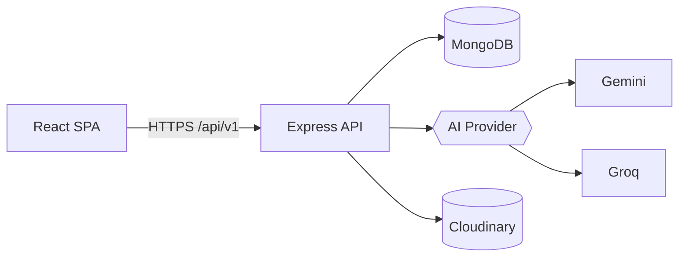
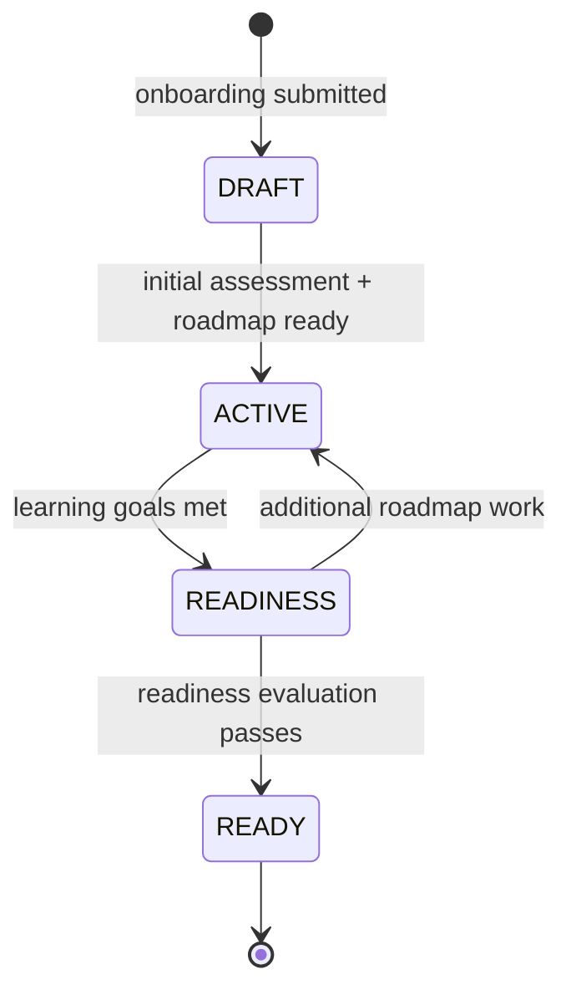
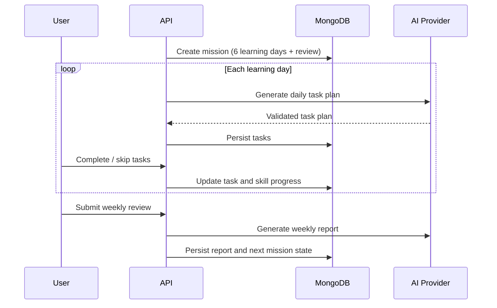

# Architecture

CareerSaathi is a modular monolith: an Express 5 API backed by MongoDB, consumed by a React 19 single-page application. Both live in the same repository and share no runtime code.

## System Overview



- The SPA authenticates with a Bearer access token and an httpOnly refresh cookie.
- All state is persisted in MongoDB; the API is otherwise stateless.
- AI calls go through `shared/ai/ai.provider.factory.ts`, which selects Gemini or Groq from `AI_PROVIDER`.
- Resume files are uploaded to Cloudinary and referenced by public id.

## Backend Layering

Requests follow a consistent path:

```
route -> validation -> authenticate -> controller -> service/workflow -> repository -> Mongoose model
```

- `routes/*.routes.ts` declare paths and attach middleware.
- `*.validation.ts` files hold Joi schemas used by `validateRequest`.
- Controllers stay thin and delegate to services or workflows.
- Repositories own all database access; services contain business rules.
- `*.mapper.ts` files convert documents to response DTOs so persistence shapes never leak to the client.
- Cross-cutting concerns live in `core/` (errors, middleware, constants) and `shared/` (AI, storage, time, utilities).

Module layout:

| Module | Responsibility |
| --- | --- |
| `auth` | Registration, login, refresh rotation, logout, sessions |
| `career-journey` | Target role, journey state, setup data |
| `assessment` | Initial, weekly, and monthly assessments |
| `user-skill` | Selected skills and proficiency |
| `roadmap` | AI roadmap generation and adaptive updates |
| `mission` | Seven-day mission lifecycle |
| `daily-task` | Task generation and completion |
| `weekly-review` | Weekly reflection submission |
| `weekly-report` / `monthly-report` | AI-generated progress reports |
| `readiness` | Readiness scoring and mock interviews |
| `resume` | Resume upload, text extraction, skill analysis, and retrieval |
| `workspace` | Aggregated dashboard payload |

## Career Journey State Machine



`DRAFT` is editable onboarding data. Entering `ACTIVE` starts the mission loop. `READINESS` and `READY` stop mission generation. Only one journey may be active per user.

## Mission and Weekly Cycle

A mission lasts seven days: six learning days followed by a review day.



Weekly reviews produce an AI report. Significant gaps can trigger an adaptive roadmap update before the next mission. A completed `RESUME` assessment from the previous mission also contributes skills scoring below 60% to the next mission's revision plans.

### Monthly Cycle

Every 28 days the system evaluates whether a monthly report is due. Monthly reports aggregate assessment, skill, mission, and interview data and can adjust the roadmap.

## Readiness Model

Readiness is computed from mock interviews and skill progress:

| Component | Weight | Threshold |
| --- | --- | --- |
| Skill score | 0.35 | 70 |
| Technical interview | 0.25 | 70 |
| Problem solving | 0.20 | 70 |
| Communication | 0.20 | 65 |

An overall score of 70 is required, and at least three mock interviews must be recorded. Passing the evaluation moves the journey to `READY`.

## Authentication and Sessions

- `POST /auth/register` and `POST /auth/login` return an access token and set a refresh cookie.
- Access tokens are verified by `authenticate` middleware and exposed as `req.user`.
- Refresh tokens are rotated on every `POST /auth/refresh`. Only SHA-256 hashes are stored in `User.refreshTokenHashes`.
- `POST /auth/logout` removes the presented refresh token hash and clears the cookie. It resolves the user from the refresh token so logout works even after the access token expires.
- `POST /auth/logout-all` requires authentication and clears every stored refresh hash.
- Presenting a revoked or already-rotated refresh token returns `401`.

## Transactions

Multi-document writes use `shared/utils/transaction.util.ts`. The helper:

- runs the operation in a MongoDB session,
- retries transient failures (write conflicts, transient transaction errors, lock timeouts) up to three times with backoff,
- retries commits with unknown results before failing,
- always ends the session.

Application and validation errors are never retried.

## Time Handling

`shared/time/app-clock.ts` provides `appClock.now()`. In non-production environments `TEST_APP_DATE` can pin the clock to a fixed date for deterministic testing. Date helpers in `shared/utils/date.util.ts` perform calendar-day arithmetic.

## AI Pipeline

1. A workflow builds a prompt from the user's journey, skills, roadmap, and recent progress.
2. `aiService` calls the configured provider.
3. `aiValidator` schema-validates and normalises the response.
4. Invalid responses trigger bounded retries.
5. Only validated data is persisted.

Provider selection and keys are configured with `AI_PROVIDER`, `GEMINI_API_KEY`, and `GROQ_API_KEY`.

## Resume Analysis

1. Upload parses PDF or DOCX text with `unpdf` or `mammoth`; legacy `.doc` files are rejected.
2. Replacing a resume creates the new record and soft-deletes the previous one in a transaction; the previous stored file is removed only after commit.
3. Extracted text is stored in a private, non-queryable field and never returned by the API.
4. `POST /resume/:resumeId/analyze` sends truncated resume text to the configured AI provider with a prompt-injection-resistant system instruction.
5. `aiValidator` rejects malformed extraction output before anything is persisted.
6. Skill names are matched against `SkillCatalog.name`, `SkillCatalog.slug`, and `SkillCatalog.aliases`; AI output never supplies database ids.
7. Evidence, confidence, and catalog matches are stored on the resume. Unknown skills are retained as unmatched suggestions.
8. Analysis never writes to `UserSkill.currentScore`.
9. Confirmation replaces the resume's accepted skill-id set. During `DRAFT` onboarding it idempotently creates/synchronizes the journey's `UserSkill` records so the confirmed resume skills become the exact selected set; once the journey is `ACTIVE`, confirmation is additive and reports newly selected ids in `newSkillCatalogIds`. It never changes scores or clears existing active selections.
10. Re-analysis clears the prior confirmation so stale accepted skills cannot be merged.
11. An `ANALYZING` resume older than ten minutes is reset to `ANALYSIS_FAILED` on the next analysis request so interrupted work cannot lock the resume permanently.

Upload and analysis endpoints are rate-limited per user. Resume status follows `UPLOADED -> ANALYZING -> ANALYZED | ANALYSIS_FAILED`.

## Observability and Errors

- `pino` is the logger; `pino-http` attaches a request id and logs every request.
- `AppError` carries an HTTP status and a safe message. The global error middleware logs unexpected errors and returns a generic `500`.
- `GET /health` is a liveness probe. `GET /health/ready` reports MongoDB connection state and returns `503` when the database is unavailable.

## Frontend Architecture

- `app/` wires the Redux store, router, providers, and the `AuthInitializer`.
- `features/*` contains feature slices, RTK Query endpoints, components, hooks, and pages.
- `features/resume` owns resume upload, analysis, skill-confirmation, and resume-skill assessment API types. Its card is rendered during onboarding and from the profile page; after profile confirmation it surfaces unassessed confirmed skills.
- `shared/api` owns the axios instance, the RTK Query base query, and auth header injection.
- `features/auth/slice/authSlice.ts` stores the access token and current user; the refresh token never reaches JavaScript.
- Route guards (`OnboardingGuard`, `WorkspaceGuard`, `AppEntry`) derive navigation from authentication and journey state.
