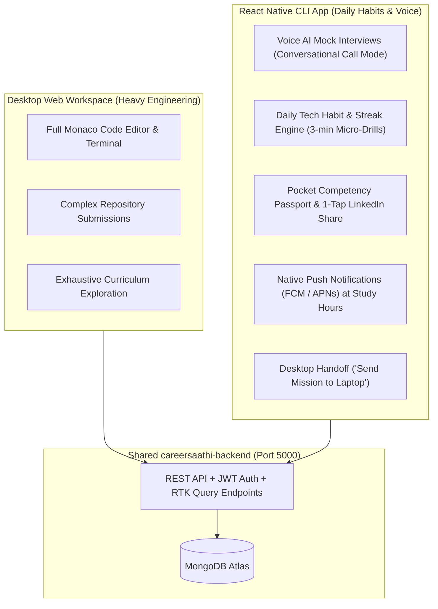
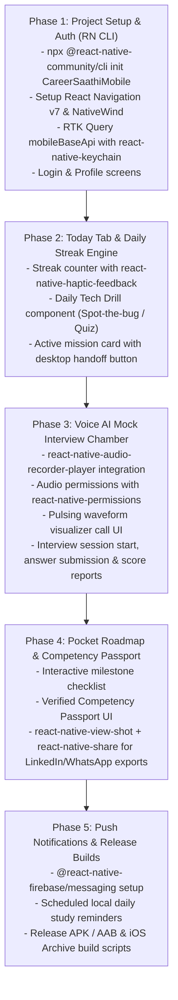

# CareerSaathi Mobile App — Master Architecture & Implementation Blueprint (React Native CLI)

> **Notice for New Mobile Repository Session**:  
> This document is the authoritative architectural specification and implementation guide for the dedicated `career-saathi-app` repository built using **Pure React Native Community CLI** (Bare React Native, non-Expo). It provides complete component hierarchies, React Navigation structures, RTK Query integration patterns, native permissions, audio/voice processing mechanics, and a step-by-step rollout sequence.

---

## 1. Executive Summary & Mobile Philosophy

The CareerSaathi mobile app functions as an **Autonomous Career Companion & Voice Interview Chamber**. Rather than forcing heavy code editors onto a phone screen, the mobile app focuses on high-frequency, mobile-first workflows:



### The 4 Mobile "Superpowers"

1. **Conversational Voice Interview Chamber**: Practice technical, behavioral, and system design mock interviews naturally using native mobile microphones and AirPods with real-time waveform visualizers.
2. **Daily Tech Habit & Streak Engine**: Duolingo-style 3-minute technical micro-drills ("Spot the Bug", "Predict the Output", "System Design Decision") with flame streak counters (`🔥`) and native haptic feedback.
3. **Pocket Competency Passport & Social Cards**: 1-tap social-card generation using `react-native-view-shot` + `react-native-share` for LinkedIn and WhatsApp stories displaying verified skill percentiles.
4. **Native Push Notifications & Desktop Handoff**: Firebase Cloud Messaging (FCM) driving learners back to their laptops at their declared daily study times.

---

## 2. Technology Stack & Native Dependencies (RN CLI)

| Layer                  | Technology                                                                          | Justification                                                                             |
| :--------------------- | :---------------------------------------------------------------------------------- | :---------------------------------------------------------------------------------------- |
| **Core Framework**     | **React Native CLI (v0.76+) with TypeScript**                                       | Bare React Native for full native module access and fine-grained Android/iOS control.     |
| **Navigation**         | **React Navigation v7** (`@react-navigation/native`, `native-stack`, `bottom-tabs`) | Native screen performance with `react-native-screens` & `react-native-safe-area-context`. |
| **State & API**        | **Redux Toolkit (RTK) & RTK Query**                                                 | Reuses 90% of web API definitions, models, caching, and tag invalidation.                 |
| **Styling**            | **NativeWind v4** (Tailwind CSS for React Native)                                   | Identical design tokens and utility classes as the CareerSaathi web workspace.            |
| **Voice & Audio**      | **`react-native-audio-recorder-player`**                                            | Production-grade audio recording, native mic streams, and playback.                       |
| **Permissions**        | **`react-native-permissions`**                                                      | Standardized cross-platform microphone and notification permission handling.              |
| **Icons & Vectors**    | **`lucide-react-native` + `react-native-svg`**                                      | Visual parity with the CareerSaathi web design system.                                    |
| **Secure Storage**     | **`react-native-keychain`**                                                         | Hardware-backed iOS Keychain and Android Keystore storage for JWT tokens.                 |
| **Push Notifications** | **`@react-native-firebase/app` + `@react-native-firebase/messaging`**               | Direct Firebase Cloud Messaging (FCM) for background and foreground notifications.        |
| **Haptics**            | **`react-native-haptic-feedback`**                                                  | Physical tactile feedback on quiz completion, streak increments, and voice interactions.  |
| **Sharing**            | **`react-native-view-shot` + `react-native-share`**                                 | Capture Competency Passport view as PNG and open native iOS/Android share sheets.         |

---

## 3. Directory Structure (`career-saathi-app`)

```
careersaathi-mobile/
├── android/                             # Android native Gradle project
│   └── app/src/main/AndroidManifest.xml # Permissions (RECORD_AUDIO, INTERNET)
├── ios/                                 # iOS native Xcode project
│   ├── Podfile                          # CocoaPods dependencies
│   └── CareerSaathiMobile/Info.plist    # NSMicrophoneUsageDescription
├── src/
│   ├── App.tsx                          # Root Provider: Redux, Navigation, Toast
│   ├── app/
│   │   ├── store.ts                     # Redux Store with RTK Query
│   │   └── hooks.ts                     # useAppDispatch, useAppSelector
│   ├── navigation/
│   │   ├── RootNavigator.tsx            # Auth vs Main Stack Switcher
│   │   ├── AuthNavigator.tsx            # Login & Register Stack
│   │   ├── AppNavigator.tsx             # Bottom Tab Navigator
│   │   └── types.ts                     # React Navigation param lists
│   ├── shared/
│   │   ├── api/
│   │   │   ├── mobileBaseApi.ts         # RTK Query baseApi with Keychain Bearer auth
│   │   │   └── tokenStorage.ts          # react-native-keychain token manager
│   │   ├── components/
│   │   │   ├── ScreenWrapper.tsx        # SafeAreaView + KeyboardAvoidingView
│   │   │   ├── AudioVisualizer.tsx      # Pulsing wave animation for voice AI
│   │   │   ├── StreakBadge.tsx          # Animated flame streak counter
│   │   │   └── Card.tsx                 # Standard styled native card
│   │   └── theme/
│   │       └── colors.ts                # Brand colors matching web
│   └── features/
│       ├── auth/
│       │   ├── api/authApi.ts           # Login, Refresh, Me endpoints
│       │   ├── pages/                   # LoginScreen.tsx, RegisterScreen.tsx
│       │   └── slice/authSlice.ts       # Auth state
│       ├── home/
│       │   ├── api/dailyDrillApi.ts     # Question of the day endpoint
│       │   ├── pages/HomeScreen.tsx     # Today Tab (Streaks & Quizzes)
│       │   └── components/
│       │       ├── DailyDrillCard.tsx   # Spot-the-bug / Quiz card
│       │       └── ActiveMissionCard.tsx# Current milestone + desktop handoff
│       ├── interview/
│       │   ├── api/interviewApi.ts      # Start, submit answer, finish interview
│       │   ├── pages/
│       │   │   ├── InterviewHubScreen.tsx   # Track selector & past scores
│       │   │   └── ActiveCallScreen.tsx     # Fullscreen voice call interface
│       │   ├── components/
│       │   │   └── FeedbackModal.tsx        # Verbal score & analysis report
│       │   └── hooks/
│       │       └── useVoiceRecorder.ts      # react-native-audio-recorder-player hook
│       ├── roadmap/
│       │   ├── api/roadmapApi.ts        # Active journey & roadmap items
│       │   ├── pages/RoadmapScreen.tsx  # Pocket Roadmap Companion
│       │   └── components/
│       │       └── MilestoneList.tsx    # Interactive checklist
│       ├── passport/
│       │   ├── api/passportApi.ts       # Competency passport data
│       │   ├── pages/PassportScreen.tsx # Verified badge & skill radar
│       │   └── components/
│       │       └── ShareableCard.tsx    # View-shot ready digital badge
│       └── notifications/
│           ├── api/notificationsApi.ts  # Push token registration
│           └── services/fcmService.ts   # Firebase messaging background handler
```

---

## 4. Backend API Integration & Shared Endpoints

The mobile app connects to the existing `careersaathi-backend` (port 5000 in dev, or production URL). **Over 90% of endpoints are already built and tested**:

### 4.1 Reused Endpoints

| Category      | Endpoint                                           | Method | Mobile Usage                                             |
| :------------ | :------------------------------------------------- | :----- | :------------------------------------------------------- |
| **Auth**      | `/api/v1/auth/login`                               | `POST` | Authenticate learner, store tokens in Keychain.          |
| **Auth**      | `/api/v1/auth/me`                                  | `GET`  | Fetch profile, roles, headline, photo.                   |
| **Workspace** | `/api/v1/workspace`                                | `GET`  | Fetch current active journey, stage, and active mission. |
| **Journeys**  | `/api/v1/career-journeys`                          | `GET`  | List all journeys for 1-tap switching.                   |
| **Journeys**  | `/api/v1/career-journeys/:id/switch-active`        | `POST` | Switch active workspace target from mobile.              |
| **Roadmap**   | `/api/v1/roadmaps/active`                          | `GET`  | Load pocket roadmap milestones and task progress.        |
| **Practice**  | `/api/v1/practice/interview/session`               | `POST` | Initialize a voice mock interview session.               |
| **Practice**  | `/api/v1/practice/interview/answer`                | `POST` | Submit voice transcript / audio response.                |
| **Practice**  | `/api/v1/practice/interview/sessions/:id/finish`   | `POST` | Finalize interview and generate AI evaluation.           |
| **Passport**  | `/api/v1/user-skills/career-journeys/:id/passport` | `GET`  | Fetch verified skill ratings and evidence breakdown.     |
| **Alerts**    | `/api/v1/notifications`                            | `GET`  | List in-app notifications with unread counts.            |

### 4.2 New Backend Endpoint Required

```typescript
// POST /api/v1/notifications/push-token
// Body: { fcmToken: string, platform: "android" | "ios" }
// Stores device token on user record to trigger Firebase push notifications.
```

---

## 5. Native Configurations (Android & iOS)

### 5.1 Android Configuration (`android/app/src/main/AndroidManifest.xml`)

```xml
<manifest xmlns:android="http://schemas.android.com/apk/res/android">
    <uses-permission android:name="android.permission.INTERNET" />
    <uses-permission android:name="android.permission.RECORD_AUDIO" />
    <uses-permission android:name="android.permission.MODIFY_AUDIO_SETTINGS" />
    <uses-permission android:name="android.permission.VIBRATE" />
    <uses-permission android:name="android.permission.POST_NOTIFICATIONS" />

    <application
      android:name=".MainApplication"
      android:label="@string/app_name"
      android:icon="@mipmap/ic_launcher"
      android:allowBackup="false"
      android:theme="@style/AppTheme">
      <!-- ... -->
    </application>
</manifest>
```

### 5.2 iOS Configuration (`ios/CareerSaathiMobile/Info.plist`)

```xml
<dict>
    <key>NSMicrophoneUsageDescription</key>
    <string>CareerSaathi requires microphone access for voice AI mock interviews.</string>
    <key>UIBackgroundModes</key>
    <array>
        <string>audio</string>
        <string>remote-notification</string>
    </array>
</dict>
```

---

## 6. Implementation & Delivery Roadmap



---

## 7. Commands to Initialize the Mobile Repository (RN CLI)

When you are ready to create the `careersaathi-mobile` repository in your next session, execute:

```bash
# 1. Initialize Bare React Native with TypeScript
npx @react-native-community/cli@latest init CareerSaathiMobile --template react-native-template-typescript
cd CareerSaathiMobile

# 2. Install Navigation Core
npm install @react-navigation/native @react-navigation/native-stack @react-navigation/bottom-tabs
npm install react-native-screens react-native-safe-area-context

# 3. Install State & API Layer (RTK Query)
npm install @reduxjs/toolkit react-redux

# 4. Install Native Modules (Audio, Keychain, Haptics, Sharing, Icons)
npm install react-native-audio-recorder-player react-native-permissions
npm install react-native-keychain react-native-haptic-feedback
npm install react-native-view-shot react-native-share
npm install lucide-react-native react-native-svg

# 5. Install NativeWind (Tailwind CSS for React Native CLI)
npm install nativewind tailwindcss react-native-reanimated

# 6. Install iOS CocoaPods (macOS only)
# cd ios && pod install && cd ..

# 7. Start Metro Bundler
npx react-native start
```

---

## 8. Summary Checklist for Mobile Session

- [ ] Use `docs/MOBILE_APP_BLUEPRINT.md` as the primary instruction document.
- [ ] Connect `mobileBaseApi` to `http://10.0.2.2:5000/api/v1` (Android Emulator) or local Wi-Fi IP for physical devices.
- [ ] Treat voice mock interviews as the hero differentiator.
- [ ] Maintain focus on daily habits, streaks, and desktop handoffs rather than heavy text editing.
